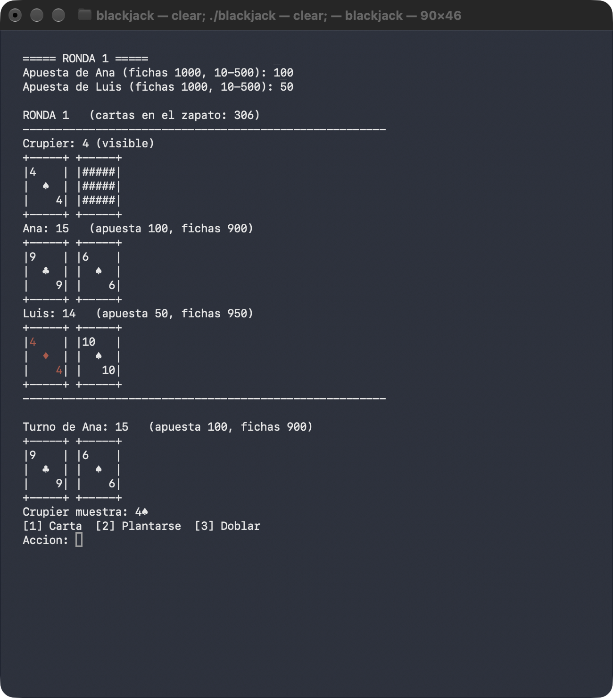

# Blackjack en consola

Proyecto de EIF201 Programación I, Universidad Nacional. Es un juego de Blackjack en C++ que se juega en la consola contra el crupier.

Integrante: Gustavo Rojas Porras (402350187)

## Qué incluye

- De 1 a 3 jugadores, cada uno con 1000 fichas y apuestas de 10 a 500.
- Zapato de 6 mazos barajado una sola vez al inicio de la partida.
- Seguro, carta, plantarse, doblar y dividir.
- Turno del crupier, que pide hasta tener 17 o más.
- Pagos 1:1, 3:2 para el blackjack, empate y 2:1 para el seguro.
- Cartas dibujadas en la consola, con corazones y rombos en rojo.
- Resumen de fichas al final de la partida.

## Compilar

Con g++ (macOS o Linux):

    make

Con cl (Developer Command Prompt de Visual Studio):

    cl /EHsc /std:c++17 src\*.cpp /Fe:blackjack.exe

Los pasos completos, también con Visual Studio, están en [docs/compilacion.md](docs/compilacion.md).

## Ejecutar

    ./blackjack

En Windows: `blackjack.exe`

## Documentación

| Documento | Contenido |
|---|---|
| [docs/juego.md](docs/juego.md) | Cómo jugar, paso a paso y con capturas |
| [docs/compilacion.md](docs/compilacion.md) | Cómo compilar con cl, Visual Studio y g++ |
| [docs/uml.pdf](docs/uml.pdf) | Diagrama de clases UML |
| [docs/documento-formal.pdf](docs/documento-formal.pdf) | Documento formal: reglas, ejemplos, diseño, plan de acción, minutas y avance |
| [docs/capturas/](docs/capturas/) | Capturas del juego |

## Carpetas

- `src/` código fuente: un par de archivos .h y .cpp por clase, más `main.cpp` y `Constantes.h`
- `docs/` guías, diagrama UML, documento formal y capturas
- `Makefile` compilación con g++
