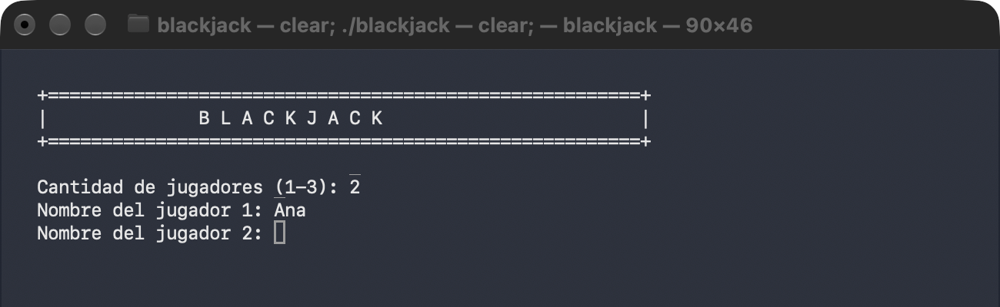
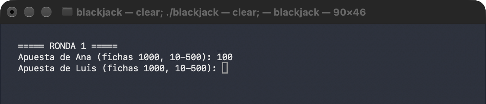
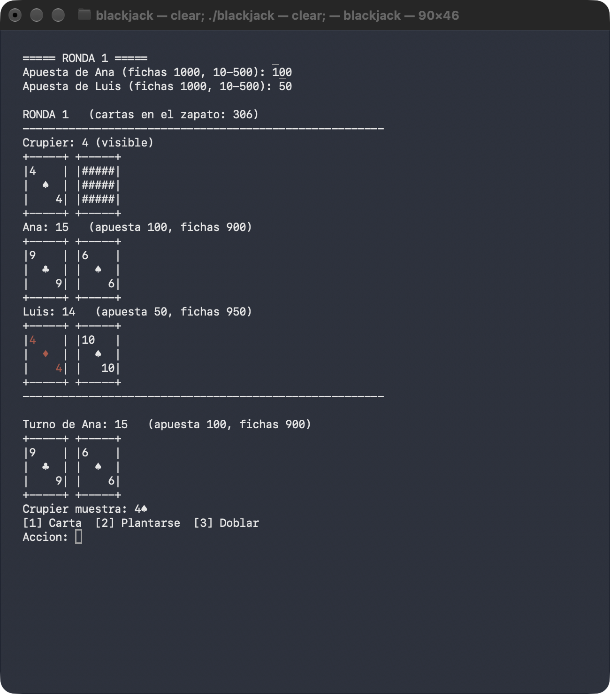
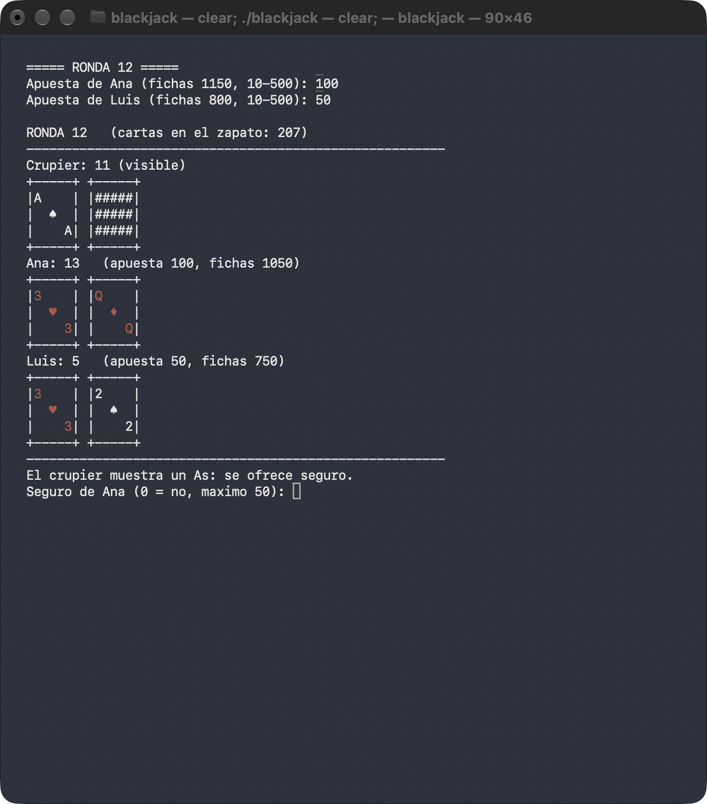
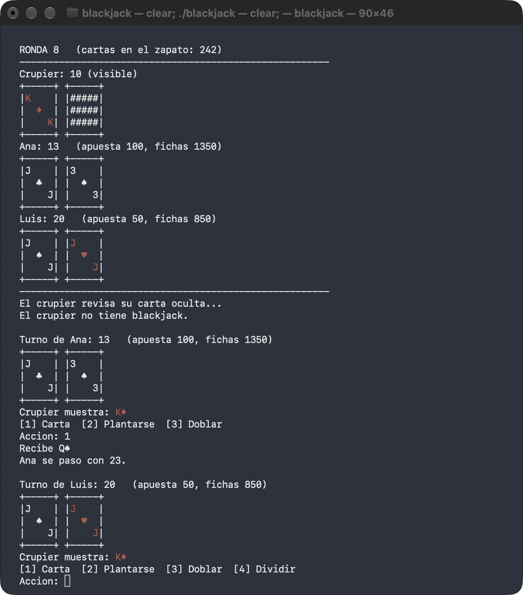
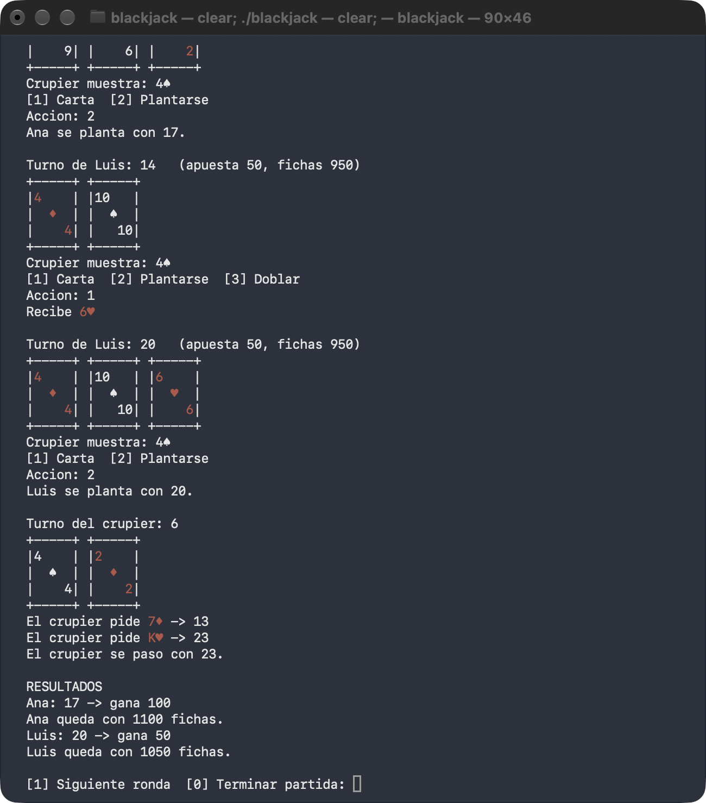
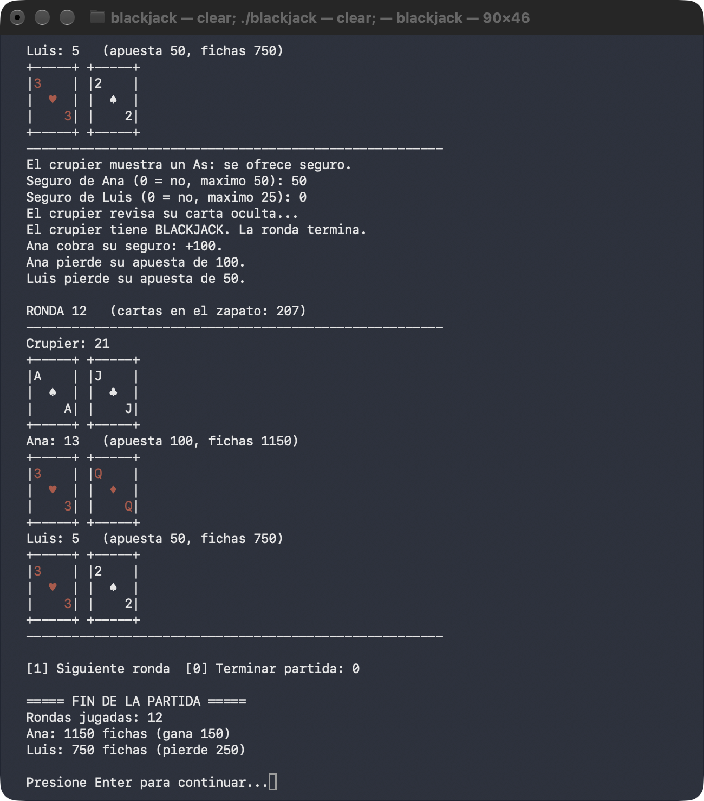

# Como jugar

Las reglas completas del Blackjack están en `documento-formal.pdf`. Esta guía explica cómo se juega en este programa.

## 1. Compilar y ejecutar

    make
    ./blackjack

En Windows se compila con `cl` o con Visual Studio y se ejecuta `blackjack.exe`. Los pasos están en [compilacion.md](compilacion.md).

## 2. Empezar la partida

El programa pregunta cuántos jugadores van a jugar (de 1 a 3) y el nombre de cada uno. Todos empiezan con **1000 fichas** y juegan contra el crupier, no entre ellos.

## 3. Apostar

Al inicio de cada ronda, cada jugador escribe su apuesta: de **10 a 500 fichas**, sin pasarse de las que tiene. Quien tenga menos de 10 fichas no juega esa ronda.

## 4. Leer la mesa

Después de apostar se reparten las cartas: dos boca arriba para cada jugador, y para el crupier una boca arriba y otra boca abajo. La carta oculta del crupier se dibuja como `#####`, y junto a su nombre aparece solo el valor de la carta visible.

- Al lado de cada jugador se ve el valor de su mano, su apuesta y las fichas que le quedan.
- Las cartas de corazones (♥) y rombos (♦) salen en rojo, y las de tréboles (♣) y picas (♠) en el color normal de la consola. El palo no cambia el valor de la carta.
- Arriba se muestra cuántas cartas quedan en el zapato (6 mazos, 312 cartas al empezar).

## 5. Seguro

Si la carta visible del crupier es un As, se ofrece un seguro a cada jugador. Se escribe cuánto asegurar, hasta la mitad de la apuesta, o `0` para no asegurar.

- Si el crupier tiene Blackjack, el seguro paga 2 a 1.
- Si no lo tiene, el seguro se pierde y la ronda sigue.

Cuando la carta visible vale 10 o es un As, el crupier revisa su carta oculta. Si tiene Blackjack, la muestra y la ronda termina: solo empata quien también tenga Blackjack.

## 6. Turno de cada jugador

Cada jugador juega su mano escribiendo el número de una acción:

| Opción | Acción | Cuándo aparece |
|---|---|---|
| `[1]` | Carta | Siempre. Se puede pedir las veces que se quiera. |
| `[2]` | Plantarse | Siempre. Termina el turno de esa mano. |
| `[3]` | Doblar | Solo con las 2 primeras cartas y fichas para igualar la apuesta. Duplica la apuesta, recibe una sola carta y se planta. |
| `[4]` | Dividir | Solo con las 2 primeras cartas, si valen lo mismo (por ejemplo 8 y 8, o K y 10), y con fichas para una segunda apuesta igual. Cada mano recibe una carta y se juega por separado. Solo se divide una vez. |

- Si la mano pasa de 21, el jugador se pasa y pierde esa apuesta.
- Si llega a 21, se planta solo.
- Con Blackjack (As y una carta de 10 al inicio) no juega su turno: espera al crupier.

## 7. Turno del crupier

El crupier revela su carta oculta y pide cartas hasta tener **17 o más**. No decide nada: siempre sigue esa regla. Si todas las manos se pasaron o son Blackjack, ya no pide.

## 8. Pagos

| Resultado | Pago |
|---|---|
| Ganar (más puntos que el crupier, o el crupier se pasa) | 1 a 1 |
| Blackjack del jugador | 3 a 2 (redondeado hacia abajo) |
| Empate (mismos puntos, o ambos con Blackjack) | Se devuelve la apuesta |
| Perder o pasarse de 21 | Se pierde la apuesta |
| Seguro, si el crupier tiene Blackjack | 2 a 1 |

Un 21 después de dividir no es Blackjack: se paga 1 a 1.

## 9. Fin de la partida

Al terminar cada ronda se elige `[1]` para jugar otra o `[0]` para terminar. La partida también termina sola si:

- no quedan cartas suficientes en el zapato (no se vuelve a barajar), o
- ningún jugador tiene fichas para la apuesta mínima.

Al final se muestra un resumen con las rondas jugadas y cuántas fichas ganó o perdió cada jugador.

## Entradas inválidas

Si se escribe algo que no es un número, un número fuera de rango o un nombre vacío, el programa avisa y vuelve a preguntar.
